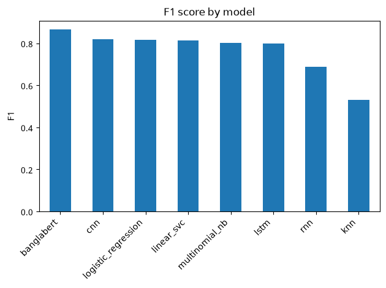
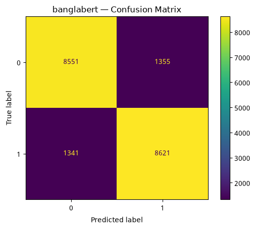

# Bengali Hate Speech Classification

Binary hate-speech detection for Bengali social-media text (Hate / Not-Hate). The project compares 8 supervised models, from TF-IDF baselines to a fine-tuned BanglaBERT, explains their predictions with LIME, SHAP and Captum, and tests how well they hold up when a slur is added to a sentence and when a statement is negated.

> **Content warning:** the dataset, the notebook outputs and some figures contain offensive and hateful Bengali language.

## Results

Test set: 19,868 comments (15% held out, stratified).

| Model | Accuracy | Precision | Recall | F1 | ROC-AUC |
|---|---|---|---|---|---|
| **BanglaBERT** (fine-tuned, 2 epochs) | **0.864** | 0.864 | **0.865** | **0.865** | **0.942** |
| CNN (PyTorch) | 0.821 | 0.826 | 0.814 | 0.820 | 0.904 |
| Logistic Regression (TF-IDF) | 0.823 | 0.849 | 0.788 | 0.817 | 0.907 |
| Linear SVC (TF-IDF, calibrated) | 0.820 | 0.843 | 0.788 | 0.815 | 0.903 |
| Multinomial Naive Bayes (TF-IDF) | 0.800 | 0.798 | 0.805 | 0.802 | 0.891 |
| LSTM (PyTorch) | 0.815 | **0.876** | 0.736 | 0.800 | 0.904 |
| RNN (PyTorch) | 0.679 | 0.671 | 0.706 | 0.688 | 0.746 |
| k-NN (TF-IDF, k=5) | 0.609 | 0.668 | 0.439 | 0.530 | 0.666 |

<p align="center">
  
  
</p>

### Key findings

- **BanglaBERT is clearly the best model**, about 4.5 F1 points ahead of the next one (CNN). The TF-IDF linear models (Logistic Regression, Linear SVC) are close behind the CNN and train in seconds.
- **The models rely on single words.** Adding one top hate word to the end of a Not-Hate comment flipped the prediction to Hate for 9 of 9 eligible comments for both CNN and BanglaBERT, 8 of 9 for Linear SVC, and 7 of 8 for Logistic Regression and LSTM.
- **No model handles negation.** In 13 hand-written statement / negated-statement pairs (for example "সে একটা শয়তান" → "সে শয়তান না"), only the RNN flipped from Hate to Not-Hate, and only once. That's 1 of the 10 pairs it first called Hate. Every other model, BanglaBERT included, flipped none.
- **There's a likely identity-term bias.** The word with the strongest Hate weight in Logistic Regression is নাস্তিক ("atheist"), ahead of every slur. The model has learned the identity word itself as a hate signal, so neutral sentences that mention it may be flagged.
- **Hate vs. Not-Hate doesn't appear as natural clusters.** K-Means (k=2) on the TF-IDF features agrees with the true labels no better than chance: Adjusted Rand Index 0.0008, silhouette 0.012.

Full metrics are in [`results/`](results/) and all plots are in [`figures/`](figures/).

## Dataset

[BengaliSent140](https://www.kaggle.com/datasets/akifislam/bengalisent140) (Akif Islam, Sujan Kumar Roy, Md. Ekramul Hamid; [paper](https://arxiv.org/abs/2601.20129)) merges seven existing Bengali text datasets into one binary corpus. The copy used here has 132,451 rows: 66,039 Not-Hate (0) and 66,412 Hate (1). It's split 70 / 15 / 15 into train, validation and test, stratified by label with seed 42.

The dataset isn't included in this repository. Download it from Kaggle. If you use it, cite the authors' paper (see [Citation](#citation)).

## Method

| Step | Details |
|---|---|
| Cleaning | Unicode NFKC normalization; URLs, @mentions and punctuation removed. A Bengali-aware token pattern keeps vowel signs and conjuncts inside their words. |
| Classical models | TF-IDF (unigrams + bigrams, 20,000 features), then Logistic Regression, Linear SVC, Multinomial NB and k-NN |
| Deep models | Word-level vocabulary (20,000) built from the training split. Sequences are padded to the 95th-percentile training length (43 tokens). RNN, LSTM and a 1-D CNN with 3/4/5-gram filters are trained for 5 epochs. |
| Transformer | [`csebuetnlp/banglabert`](https://huggingface.co/csebuetnlp/banglabert), fine-tuned for 2 epochs (AdamW, lr 2e-5). The maximum length (55 sub-word tokens) is the 95th percentile of training lengths. |
| Explainability | LIME (all 4 classical models), SHAP (linear explainer for Logistic Regression, text masker for the others), Captum Layer Integrated Gradients (RNN, LSTM, CNN, BanglaBERT) |
| Unsupervised | K-Means on a 100-dimension TruncatedSVD (LSA) projection of the TF-IDF features |
| Robustness | Hate-word injection test (10 test comments) and a negation test (13 hand-written pairs). Each model's rate is counted only over the examples it classified correctly before the change. |

## Repository structure

```
├── bengali_hate_speech_classification.ipynb   # the full pipeline, with outputs
├── results/                                   # metrics per model, comparison table, negation summary (CSV / JSON)
├── figures/                                   # every plot from the notebook
├── requirements.txt
└── README.md
```

The notebook is stored with its outputs so it can be read on GitHub without running it. The large interactive LIME/SHAP views are replaced with a short note; run the notebook in Colab to see them.

## How to run

The notebook is built for **Google Colab** with a **T4 GPU** and keeps its data, models and results in Google Drive.

1. Download `bengalisent140.csv` from Kaggle and upload it to your Google Drive at `MyDrive/bengali_hate_speech/data/bengalisent140.csv`.
2. Open the notebook in Colab and choose **Runtime → Change runtime type → T4 GPU**.
3. Choose **Runtime → Run all** and allow access to Google Drive.
4. The first cell upgrades matplotlib to 3.11, which is needed to draw Bengali text in plots correctly. The run then stops and asks you to restart. Choose **Runtime → Restart session**, then **Run all** again.

Trained models are saved to `MyDrive/bengali_hate_speech/models/` and reloaded on later runs. Set `FORCE_RETRAIN = True` in the Config cell to retrain everything, for example after changing a setting. The trained models are not in this repository: the BanglaBERT weights alone are 442 MB, above GitHub's 100 MB file limit. Running the notebook recreates them.

Tested on Google Colab with Python 3.14, matplotlib 3.11.2 and transformers 5.20.2.

## Limitations

- **The RNN and LSTM likely suffer from end padding.** Sequences are padded at the end, and both models classify from their last hidden state, so for short comments the final steps the model reads are padding. This is a likely reason for the RNN's weak score. Packing the sequences (`pack_padded_sequence`) or padding at the start would probably help.
- **There was no hyperparameter tuning.** BanglaBERT was trained for only 2 epochs, and every model was trained once with one seed, so small differences between models (for example CNN vs. Logistic Regression) may not be meaningful.
- **The robustness tests are small.** 10 injection examples and 13 negation pairs show a pattern, but they are not a full benchmark.
- **The BanglaBERT authors' text normalizer was not applied** before tokenization. Applying it may improve BanglaBERT's results.

## Citation

This project uses the BengaliSent140 dataset. If you use the dataset, please cite:

> Akif Islam, Sujan Kumar Roy and Md. Ekramul Hamid. *BengaliSent140: A Large-Scale Bengali Binary Sentiment Dataset for Hate and Non-Hate Speech Classification.* arXiv:2601.20129, 2026.

```bibtex
@misc{islam2026bengalisent140largescalebengalibinary,
      title={BengaliSent140: A Large-Scale Bengali Binary Sentiment Dataset for Hate and Non-Hate Speech Classification},
      author={Akif Islam and Sujan Kumar Roy and Md. Ekramul Hamid},
      year={2026},
      eprint={2601.20129},
      archivePrefix={arXiv},
      primaryClass={cs.CL},
      url={https://arxiv.org/abs/2601.20129},
}
```
